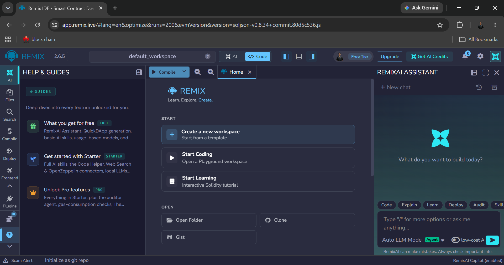

# pratikum 6 : membuat smart contract dengan solidity di remix #

## tujuan pembelajaran 
setelah menyelesaikan pratikum ini, mahasiswa diharapkan mampu :
1. memahmin konsep dasar dari smart contract pada blockchain
2. menggunakan platfrom remix untuk menulis, mengolilasi, dan men-deploy smart contract berbasis solidity
3. mengimplementasikan fungsionalitas dasar samrt contract melibatkan state variable dan fungsi
4. melakukan ineteraksi dengan smart cintact yang sudah ter-deploy melalui remix

### proses pratikum ###

1. buka [remix ide](https://remix.ethereum.org) login via gmail, bukti :

2. membuat file SupplyChainKopi.sol

3. menambahkan data pesanan baru :

4. mengupdate data :
